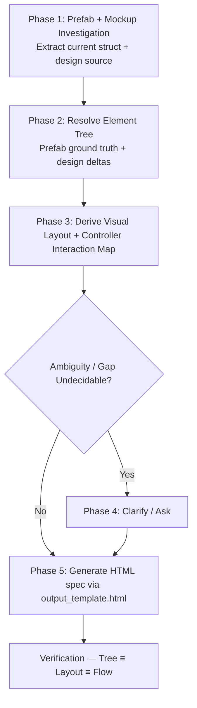

# Unity UI Design Skill (`unity-ui-design`)

Design a Unity UI feature end-to-end in one doc: **what it looks like** (HTML View + Element Tree) and **how it behaves** (mermaid flow, per-tappable interaction table, state changes, controller code skeleton). Replaces the old two-step `unity-ui-mockup` + `unity-ui-controller` pair with a single 5-phase workflow that ships one HTML spec.

**Core invariant — Spec-Singleton, Three Truths Aligned:**

```
Prefab ground truth (GameObject + components + hierarchy)
  → Element Tree 1:1 with Visual Layout 1:1 with Controller flow
```

Every node in the Element Tree appears in the Visual Layout at the same depth with the same name, and every tappable element in the Visual appears as one row in the Interaction Table, one path in the Mermaid Flow. Nothing invented — every arrow traces to a real button, a real GameObject, a real `onClick` wiring + handler.

---

## When to Use

- Designing a new UI screen/popup/HUD from a ticket or design brief.
- Updating an existing UI after a feature change (refresh the single source-of-truth doc).
- Producing a deliverable for `unity-ui-implement` to build from.
- Output target: `docs/specs/UIs/Designs/<Name>_Design.html` (or `Docs/Specs/UIs/Designs/`).

## When NOT to Use

- Building the actual prefab and wiring references — use `unity-ui-implement`.
- Full Game Design Specs / GDDs — use `unity-spec`.
- Technical architecture / system documents — use `unity-document` or `unity-technical`.
- Pure visual exploration without controller wiring (use `unity-ui-mockup` is gone — `unity-ui-design` covers it).

---

## 5-Phase Workflow (Evidence-First, Spec-Singleton)



### Phase 1: Prefab + Mockup Investigation (Evidence-Based) — REQUIRED ORDER

Do NOT guess hierarchy or interactions. Follow this exact sequence:

1. **Locate Prefab & Related Assets (always first):**
   - Search for the `.prefab` file under `Assets/**/Prefabs/` (e.g. `ScreenHome.prefab`, `PopupShop.prefab`). Check both `Assets/` and `Assets/_Project/` variants.
   - Identify associated C# controllers (`*Controller.cs`, `*CanvasController.cs`, `*View.cs`) and their `[SerializeField]` bindings — these reveal child references even when YAML is minified.
   - Check related spec documents in `docs/specs/UIs/Screens/`, `Popups/`, `Elements/`, `Designs/`, `Core/` for prior decisions.

2. **If prefab EXISTS — extract current struct as ground truth (mandatory):**
   - **Primary (Unity MCP online):** Use `execute_code` to load the prefab via `AssetDatabase.LoadAssetAtPath` and walk `transform` recursively, collecting `GetComponents<Component>()` type names per GameObject. This is the canonical struct.
     ```csharp
     // Extract exact prefab GameObject tree + components — prefab is ground truth
     System.Func<GameObject, int, string> formatTree = null;
     formatTree = (targetGo, indent) => {
         var sb = new System.Text.StringBuilder();
         var indentStr = new string(' ', indent * 2);
         var comps = targetGo.GetComponents<Component>();
         var compNames = new System.Collections.Generic.List<string>();
         foreach (var c in comps) {
             if (c == null) continue;
             compNames.Add(c.GetType().Name);
         }
         sb.AppendLine(string.Format("{0}* `{1}` ({2})", indentStr, targetGo.name, string.Join(", ", compNames.ToArray())));
         for (int i = 0; i < targetGo.transform.childCount; i++) {
             sb.Append(formatTree(targetGo.transform.GetChild(i).gameObject, indent + 1));
         }
         return sb.ToString();
     };
     var prefab = UnityEditor.AssetDatabase.LoadAssetAtPath<GameObject>("Assets/_Path/To/Prefab.prefab");
     return formatTree(prefab, 0);
     ```
   - **Fallback (MCP offline):** Read the `.prefab` YAML directly for `m_Name`, `m_Component` typeIds, and `m_Father`/`m_RootOrder` hierarchy. Cross-check with controller serialized fields (`[SerializeField] private Button closeButton;`) to fill gaps.
   - **Record:** full indented tree with every component per node, plus notes: which children are static in prefab vs. dynamically instantiated sub-prefabs (e.g. `ContentContainer` spawns `Card_Achievement`).

3. **If prefab DOES NOT exist — record as new screen:**
   - Mark `Prefab: <New>.prefab (to be created)` in the spec header.
   - Note controller/namespace conventions from sibling prefabs to propose consistent names. The Element Tree you produce becomes the creation spec.

4. **Controller investigation — wiring & logic (third):**
   - Read `Assets/_ZenoUI/Scripts/Runtime/UIController/<Name>Controller.cs` (or `Feature/<Domain>/Scripts/Runtime/UI/`).
   - Collect: `[SerializeField]` fields (which prefab nodes are wired), `Awake/OnInit/OnShow` lifecycle, `WireListeners()` / `UnwireListeners()` pattern (stored `UnityAction` identity), `onClick.AddListener(capturedIndex)`, `DOKill`/`DOPunchScale` guards, `UIManager.ShowScreenAsync` / `ShowPopupAsync` / `HidePopup` / `CloseAndDestroyPopup` keys, `ServiceLocator.Get<ICurrencyService|ILevelManager|ISettingManager|SoundManager|HapticManager>` calls, `EventBus` subscriptions, and test seams (`ShowPopupAsync<T>` virtual, `WireForTest`).
   - Also read sibling collaborators: `UIManager.cs`, `CanvasController.cs` (`Show`/`Hide` + `DOFade` + `IsVisible`), `ScreenCanvasController.cs`, `PopupCanvasController.cs`, and `ScriptableObjects/<Name>Settings.cs` for colours/pulse/timing.
   - If controller does NOT exist — record as new controller (mark `Controller: <Name>Controller.cs (to be created)` and propose namespace `ZenoGames.UI`, base `ScreenCanvasController` or `PopupCanvasController` or `MonoBehaviour` per spec).

5. **Collect Design Source (only after prefab struct is captured):**
   - Figma frame / screenshot / `docs/specs/UIs/Designs/*.html` prior version / ticket description / UX text.
   - List every visual region, card state, label, icon, and tappable the design shows — this is the target, not the ground truth.

### Phase 2: Resolve Element Tree (Source of Truth)

Build an explicit comparison before editing the Tree. Use this table form (include in working notes; summarize deltas in spec `Notes` if non-trivial):

| # | Element / Region | In Prefab | In Design | Verdict |
|---|------------------|-----------|-----------|---------|
| 1 | `Header/HeaderTitleText` | `TextMeshProUGUI` present | Title "ACHIEVEMENTS" + subtitle | ✅ Aligned |
| 2 | `ScrollRect/Viewport/ContentContainer` | Missing `ContentSizeFitter` | Scroll list with N cards | ⚠️ Add `ContentSizeFitter` + `VerticalLayoutGroup` |
| 3 | `Card_Achievement/ClaimButton` | `Button` disabled grey | Gradient orange "CLAIM" for claimable | ⚠️ Two-state variant required |

Categories: **Aligned / In Prefab Only / In Design Only / Mismatch (name/component/layout)**. Every row must have a Verdict and a disposition (keep / add / rename / remove / retarget).

Resolve to **one finalized Element Tree** — the source of truth for everything downstream:

- **Every GameObject MUST list its Unity & custom components in parentheses `(...)`** — do not omit layout/mask/input components.
  - Transforms & Canvases: `RectTransform`, `Canvas`, `CanvasScaler`, `GraphicRaycaster`, `CanvasGroup`
  - Graphics: `CanvasRenderer`, `Image`, `TextMeshProUGUI`, `Mask`, `RectMask2D`
  - Controls: `Button`, `Toggle`, `Slider`, `ScrollRect`
  - Layout: `HorizontalLayoutGroup`, `VerticalLayoutGroup`, `GridLayoutGroup`, `ContentSizeFitter`, `LayoutElement`, `AspectRatioFitter`
  - Custom: `*CanvasController`, `*Controller`, `*ButtonController`
- For progress rows, model `ProgressBar` as `Slider` (`Background` + `FillArea`/`Fill` + `ProgressText`); reward as `RewardContainer` (`HorizontalLayoutGroup`) with `RewardIcon` + `RewardAmountText`; `ClaimButton` (`Image` + `Button` + `ClaimText`) with disabled vs. gradient claimable states. Include `LoadingIndicator` and `EmptyStateView` as siblings of `ScrollRect` when the screen loads async data (per Achievement pattern).
- **Do NOT invent elements at this stage that are not in the resolved Tree.** The Tree is now locked — all downstream work projects from it.

### Phase 3: Derive Visual Layout + Controller Interaction Map

Two parallel derivations, both **deterministic projections of the finalized Element Tree**:

#### 3A — Visual Layout (1:1 from Tree)

- Every node in the Tree appears in the Visual Layout at the same relative depth and with the same name/label; no Visual-only blocks, no Tree-only branches.
- Build the spec's Visual Layout card:
  1. **HTML View** (styled div inside a `mockup-card`) — map each Tree region 1:1, preserve names as labels inside the HTML where feasible.
  2. **Caption `<p>`** directly below HTML — one sentence naming the Root and its primary regions.
- Layout/mask components (`VerticalLayoutGroup`, `Mask`, `ScrollRect`) that exist in the Tree MUST be annotated in the Visual's scroll caption line — they are not visual-only decorations.

#### 3B — Interaction Map (one row per tappable element)

| # | Element (Mockup label → Prefab GO) | Prefab Node | Controller Field | `onClick` Wiring | Handler | UI Change | Logic / Service Call | Navigation |
|---|-------------------------------------|-------------|----------------|------------------|---------|-----------|----------------------|------------|
| 1 | `OFFER.1` (`Button_Side`) | `LeftMenu/Button_Side` | `SideMenuController.offers[0]` | `btn.onClick.AddListener(() => ShowPopupAsync("UI.Offer1Popup"))` | `OnOfferClicked(0)` | `DOPunchScale` + push stack | `UIManager.ShowPopupAsync<PopupCanvasController>("UI.Offer1Popup")` + `HapticType.Selection` | Stack: `Popup_Offer1` above `ScreenHome` |

Rules:
- **No Inspector `onClick`** — all rows must show dynamic `AddListener` with stored `UnityAction` identity and `RemoveListener` in `OnDisable`/`OnHide`/`OnDestroy`.
- **Every navigation key is literal** — quote the exact Addressable key string (`"UI.SettingsPopup"`, `"UI.HomeScreen"`, `"UI.ConfirmPopup"`).
- **Service calls are explicit** — `ServiceLocator.TryGet<ICurrencyService>()`, `EventBus.Subscribe<CurrencyBalanceChangedEvent>`, `Time.timeScale = 0/1`, `SoundManager.PauseBGM()`, etc.
- **UI change is visual** — `DOKill` + `DOPunchScale` / `DOAnchorPosY` / `DOColor` / `DOFade` / `alpha` / `interactable` / `blocksRaycasts` / `SetActive`.

Categories: **Aligned / Mockup-Only (no prefab) / Prefab-Only (no mockup label) / Code-Mismatch**. Every row gets a Verdict and disposition. Undecidable rows go to Phase 4 clarification — do not guess.

### Phase 4: Clarification (Only When Undecidable)

Only after Phases 1–3 if a row's Verdict is undecidable from evidence. Ask the user with explicit options:

- **Destructive Actions**: Does cancel/confirm require a stacked confirmation dialog? (Yes → add `Popup_Confirm` link; No → single CTA)
- **Dismissal Policy**: Does tapping dim/backdrop close the popup, or is explicit CTA required?
- **Persistent vs Screen-Owned**: Are header/footer bars persistent canvas siblings or local to this screen?
- **Dynamic Content Bounds**: How many items/rows are expected in scroll areas or grids? (affects `ContentSizeFitter` + placeholder count)
- **Popup key unknown:** What is the Addressable key? (e.g. `UI.Offer1Popup` vs `UI.ShopPopup` — choose one literal)
- **New controller base:** `ScreenCanvasController` / `PopupCanvasController` / `MonoBehaviour`? (drives `Show`/`Hide` + `CanvasGroup` lifecycle)

Present options directly; do not proceed to Output with an unresolved Mismatch row.

### Phase 5: Output Generation — MUST follow `references/output_template.html`

Generate or update the spec at `docs/specs/UIs/Designs/<Name>_Design.html` (or `Docs/Specs/UIs/Designs/<Name>_Design.html`).

**Non-negotiable — output is template-governed:**

- Load the template via `read_skill_file("unity-ui-design", "references/output_template.html")` and follow it **byte-for-byte structure** — do not invent sections, reorder blocks, or add wrappers.
- The template is a complete dark-themed HTML file with sticky nav, numbered `<h2>` cards, badge system, and CSS variables. Replace `<PLACEHOLDERS>` with real values; keep CSS, nav links, and structure intact.
- The canonical filled example was `docs/specs/UIs/Mockups/Achievement_Mockup.md` + `docs/specs/UIs/Controllers/Home_Controller_Flow_Example.md` — the HTML template absorbs both into a single file with 10 sections.
- File-internal order is fixed: **Overview → Visual Layout → Element Tree → UI Flow Diagram → Visual Reference → Interaction Details → State Changes → Controller Code → Verification** — do not reorder.
- Header fields: `Date`, `Status`, `Prefab` (exact `.prefab` name or `(to be created)`), `Controller` (exact `.cs` path or `(to be created)`), `Related` links (relative to `../Screens/`, `../Popups/`, `../Elements/`, `../Core/`).
- Every `Related` link, every `Prefab` node, and every `Controller` function/method in diagrams/tables must use inline code + optional markdown link to the real file.
- Mermaid diagrams MUST be inside `<pre class="mermaid">` blocks — they render natively in the browser.

After populating, run Verification & Validation below before finishing.

### Verification & Validation (must pass before delivery)

- [ ] **Template adherence:** Structure matches `references/output_template.html` exactly — no missing/extra cards, no reordered sections, no `<details>` wrappers.
- [ ] **Prefab-first evidence:** If prefab existed, its extracted struct is recorded and the gap table has a disposition for every Mismatch / In-Prefab-Only / In-Design-Only row.
- [ ] **Tree completeness:** Every node has backticked name and parenthesized component list; layout/mask/input components are not omitted.
- [ ] **Tree ↔ Visual 1:1 parity:** Every Tree node appears in Visual Layout at the same hierarchy depth with the same name/count, and vice versa.
- [ ] **Visual order:** Inside the Visual Layout card: `HTML View → caption <p>`.
- [ ] **Indentation:** Element Tree uses exactly 2 spaces per depth (`* `, `  * `, `    * `, `      * `).
- [ ] **Scroll hierarchy** (for list screens): `ScrollRect` → `Viewport` (Mask) → `ContentContainer` (`VerticalLayoutGroup` + `ContentSizeFitter`); cards use `LayoutElement`; at least two card-state variants when applicable.
- [ ] **Flow completeness:** Every tappable in mockup appears as one row in Interaction Details and one path in Mermaid Flow.
- [ ] **Link discipline:** Every prefab GO, every element, every handler, and every service/UIManager key is quoted literally and linked to its file (`Assets/...`, `docs/specs/UIs/...`) where the file exists.
- [ ] **Wiring contract:** All `onClick` rows show dynamic `AddListener` with stored `UnityAction` and `RemoveListener` in `OnDisable`/`OnHide`/`OnDestroy`; no Inspector `onClick`.
- [ ] **No placeholders:** No `TODO`/`TBD`/`FIXME`; `**Related:**` links resolve; all mermaid blocks render.

---

## Template Reference

All output structure lives in `references/output_template.html` — **do not duplicate it here**. Load it with:

```
read_skill_file("unity-ui-design", "references/output_template.html")
```

Working checklist for interaction wiring lives in `references/design_checklist.md`.

---

## Formatting Rules (Non-Negotiable)

1. **HTML output only** — never `.md`. The dark-themed HTML template is the source of truth.
2. **Section Headers** in template order: `01 Overview` → `02 Visual Layout` → `03 Element Tree` → `04 UI Flow Diagram` → `05 Visual Reference` → `06 Interaction Details` → `07 State Changes` → `08 Controller Code` → `09 Verification`.
3. **Indentation:** Element Tree uses exactly 2 spaces per depth (`* `, `  * `, `    * `, `      * `).
4. **GameObject & Component Naming:**
   - Backticked GameObject name: `` `ObjectName` ``
   - Attached components in parentheses: `(RectTransform, CanvasRenderer, Image, Button)`
5. **Link Integrations:** Relative markdown links in `**Related:**` to screens, popups, elements, or controllers.
6. **No Placeholders:** Never leave `TODO`, `TBD`, or `FIXME` in the final spec.
7. **Generation invariant:** Resolve Element Tree first; then derive Visual Layout strictly from it (1:1). Do not design Visual and Tree as independent artifacts.

---

## Common Anti-Patterns

| Anti-Pattern | Why It Fails | Correction |
|---|---|---|
| Fabricating hierarchy without checking prefabs | Mismatches Unity scene/prefab structure | Use Unity MCP `execute_code` or read `.prefab` YAML — prefab struct first |
| Starting from design image before reading prefab | Prefab ground truth is lost; Tree drifts | Always extract current prefab struct first, then compare with design (Phase 1 order) |
| Visual Layout drifting from Element Tree | Reviewers/impl see two conflicting specs | Derive Visual strictly from finalized Tree; run depth-first parity check |
| Omitting layout group / mask components | Developers miss required layout containers | Always include `HorizontalLayoutGroup`, `Mask`, `CanvasGroup`, etc. in Tree and annotate in Visual |
| Inventing buttons not in mockup | Reviewer cannot trace flow to visual | Inventory mockup tappables first; every row starts from mockup |
| Drawing diagrams before Interaction Map | Diagrams drift from code | Build Interaction Map table first; derive diagrams strictly from it |
| Quoting guessed popup keys | Addressables load fails at runtime | Quote literal key from code or ask; never guess |
| Omitting `DOKill` / `RemoveListener` | Tweens stack; listeners leak on re-enable | Every row shows `DOKill` guard + stored `UnityAction` + `RemoveListener` |
| Inspector `onClick` | Breaks prefab override + test seam | Dynamic `AddListener` only; show wiring in Controller Code section |
| Missing service layer | Flow looks like UI-only magic | Every side effect names `ServiceLocator`, `EventBus`, or `UIManager` call |
| Code section with `TODO` | Spec is not implementable | Show current code verbatim or a compiling scaffold with smart comments |