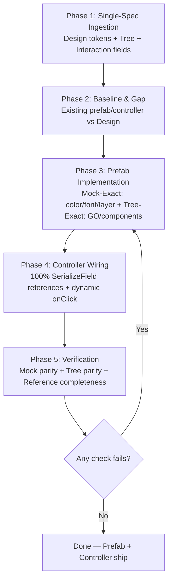

# Unity UI Implement Skill (`unity-ui-implement`)

Implement a UI task into the game: take an approved Design HTML spec and ship a real `*.prefab` + fully-wired `*Controller.cs` with zero drift. This is the **build step** — `unity-ui-design` produces the spec (one HTML file combining visual + tree + flow + code skeleton), this skill ships the artifact.

**Core invariant — Mock-Exact, Tree-Exact, References-Complete:**

```
Design Visual tokens (color/font/layer) → Prefab visuals 1:1 — zero hex/font/order drift
Design Element Tree (GO names + components + hierarchy) → Prefab hierarchy 1:1 — zero missing/renamed/extra nodes
Design Interaction (fields/handlers/keys) → Controller.cs + prefab references 1:1 — zero Missing, zero Inspector onClick
```

Every pixel, every node, every reference must be traceable to the single Design spec. If it is not in the spec, it does not go in the prefab.

---

## When to Use

- You have `docs/specs/UIs/Designs/<Name>_Design.html` (single HTML from `unity-ui-design`) and need the real `*.prefab` + `*Controller.cs` built or updated.
- Implementing a UI task — building the actual prefab and wiring the actual controller inside the Unity project.
- Creating a new Screen/Popup prefab from an approved Design.
- Updating an existing prefab whose visuals or hierarchy drifted from the Design.
- Wiring or re-wiring all controller `[SerializeField]` references after a prefab change and proving zero `Missing`.
- Pre-PR verification that mock fidelity + tree fidelity + reference completeness all pass.

## When NOT to Use

- Only one section of the spec is missing — generate or complete the Design first with `unity-ui-design`.
- Pure visual exploration without a locked Element Tree — use `unity-ui-design` to produce the Design first.
- Non-UI gameplay logic (use `unity-document` / `unity-technical` / `unity-standards`).

---

## Inputs (Required)

| Input | Path | What it provides |
|-------|------|------------------|
| **Design spec** | `docs/specs/UIs/Designs/<Name>_Design.html` | `Visual Layout` (HTML View + ASCII) with exact color hex, font family/size/weight/color, spacing, radius, shadow, layer/sibling order; `Element Tree` with every `GameObject` name + `(Component list)` + hierarchy depth; `Visual Reference` table (mockup label → prefab GO → controller field); `Interaction Details` (wiring/handler/service/nav per tappable); `Tree Flow` (handler leaf per tappable); `Controller Code` (fields, lifecycle, handlers, test seams) |

Optional but read when present: `Assets/_ZenoUI/Prefabs/**/<Name>.prefab`, `Assets/_ZenoUI/Scripts/Runtime/UIController/<Name>Controller.cs`, `Assets/_ZenoUI/Scripts/Runtime/ScriptableObjects/<Name>Settings.cs`, `UIManager.cs`, `CanvasController.cs`.

---

## 5-Phase Workflow (Spec-First, Mock-Exact)



### Phase 1: Single-Spec Ingestion (Evidence-First) — REQUIRED ORDER

Do not touch Unity before the Design is ingested. Load in this order:

1. **Design spec — visual + structural + flow ground truth (single source):**
   - Read `Visual Layout` HTML inside the Design: extract every design token — `color` hex (e.g. `#1E2142`, `#FFB800`, `#7B61FF`), `font-family`/`font-size`/`font-weight`/`letter-spacing`/`line-height`/`color` per `TextMeshProUGUI`, `background`/`gradient`/`border`/`border-radius`/`box-shadow` per `Image`, `padding`/`gap`/`spacing` per LayoutGroup, `alpha`/`raycastTarget`.
   - Read `Visual Layout` caption + ASCII: capture sibling `layer` order top-to-bottom — this is the `transform.GetSiblingIndex()` contract.
   - Read `Element Tree`: record every node as `depth | GO name (backticked) | (Component list) | parent`. Every component in `(...)` is mandatory — `RectTransform`, `CanvasRenderer`, `Image`, `TextMeshProUGUI`, `Button`, `Mask`, `ScrollRect`, `HorizontalLayoutGroup`, `VerticalLayoutGroup`, `ContentSizeFitter`, `LayoutElement`, `CanvasGroup`, `Canvas`, `GraphicRaycaster`, plus custom `*Controller`.
   - Read `Visual Reference` table: `mockup label → prefab GO path → controller field`. This is the reference assignment map.
   - Read `Interaction Details`: per-tappable `Wiring (WireListeners)`, `Handler`, `Next UI (DOKill + tween + SetUpdate)`, `Logic/Service`, `Navigation (literal Addressable key)`.
   - Read `Tree Flow`: confirms hierarchy + handler leaf for each tappable.
   - Read `Controller Code`: `[SerializeField]` fields (which GO/component each field expects), `Awake/OnInit/OnShow/OnHide/OnDestroy` lifecycle, `WireListeners/UnwireListeners` with stored `UnityAction`, `ShowPopupAsync<T>` test seam, `ScriptableObject` settings keys.
   - Build the **Mock Token Table**, **Tree Node Table**, **Reference Map**, and **Wiring Checklist** (see `references/implementation_checklist.md`).

2. **Cross-check inside the spec before implementing:**
   - Every `Visual Reference.prefab GO` must exist as a node in `Element Tree`. Any mismatch → flag and resolve before continuing — do not invent a GO that is in one section but not another.
   - Every `Controller Code [SerializeField]` must appear in `Visual Reference.controller field`. Orphan fields are a spec gap — flag and resolve.

### Phase 2: Baseline & Gap (Prefab + Controller Today)

Capture what exists before editing. **Unity MCP preferred, YAML fallback** (same canonical walk as design skill):

```csharp
// Canonical baseline — prefab is current truth, controller is current wiring
System.Func<GameObject,int,string> fmt=null;
fmt=(go,d)=>{
  var sb=new System.Text.StringBuilder();
  var pad=new string(' ',d*2);
  var cs=go.GetComponents<Component>();
  var ns=new System.Collections.Generic.List<string>();
  foreach(var c in cs) if(c!=null) ns.Add(c.GetType().Name);
  sb.AppendLine($"{pad}* `{go.name}` ({string.Join(", ", ns)})");
  for(int i=0;i<go.transform.childCount;i++) sb.Append(fmt(go.transform.GetChild(i).gameObject,d+1));
  return sb.ToString();
};
var prefab=UnityEditor.AssetDatabase.LoadAssetAtPath<GameObject>("Assets/_ZenoUI/Prefabs/Screens/ScreenHome.prefab");
return fmt(prefab,0);
```

- If prefab **exists**: extract full tree + components, screenshot `Inspector` for visual tokens (colors/fonts), list `Missing` references on the root controller component.
- If prefab **does not exist**: mark `Prefab: <Name>.prefab (to be created)` and note sibling prefab conventions for `Canvas`/`CanvasScaler`/`GraphicRaycaster`/`CanvasGroup` root.
- If controller **exists**: read `*.cs` for `[SerializeField]` fields, `WireListeners` pattern, `DOKill` guards, `UIManager` keys.
- If controller **does not exist**: mark `Controller: <Name>Controller.cs (to be created)` with base `ScreenCanvasController` / `PopupCanvasController` / `MonoBehaviour` per Design spec.
- Produce a **Gap Table** (one row per Tree node + per token + per reference):

| # | Item | In Spec | In Prefab/Controller Today | Verdict |
|---|------|---------|----------------------------|---------|
| 1 | `Header/HeaderTitleText` `fontSize 13 weight 800 #FFFFFF` | Design token `#FFFFFF 13/800` | `12/700 #EEEEEE` | ⚠️ Fix token |
| 2 | `ScrollRect/Viewport/ContentContainer` `VerticalLayoutGroup+ContentSizeFitter` | Tree requires both | Missing `ContentSizeFitter` | ⚠️ Add component |
| 3 | `SideMenuController.offers[0]` → `LeftMenu/Button_Side` | Reference Map row 1 | `Missing` (null) | ⚠️ Assign |

Categories: **Aligned / Spec-Only (to add) / Prefab-Only (to remove/rename) / Mismatch (fix token/component/order)**. Every row gets a disposition. Do not proceed with undecidable rows — clarify.

### Phase 3: Prefab Implementation — Mock-Exact + Tree-Exact

Implement the prefab so it is a **byte-for-byte projection of the spec**. Rules are non-negotiable:

**Tree-Exact (structure):**
- GO names are literal from `Element Tree` — backticked name is the `GameObject.name`. No renaming, no extra words, no ` (1)` suffixes except where spec explicitly shows instanced clones (`Button_Side (1)`).
- Hierarchy depth and parent are literal — `Header` is child of `<RootName>`, `TitleText` child of `Header`, `ContentContainer` child of `Viewport` child of `ScrollRect`.
- Sibling `layer` order is the Design's visual order top-to-bottom → `SetSiblingIndex` in that order. Verify via `transform.GetSiblingIndex()` walk.
- Every component in `(...)` is added with default + spec-tuned values. Do not omit `CanvasRenderer`, `LayoutElement`, `ContentSizeFitter`, `Mask`, `CanvasGroup` because they "seem optional" — they are layout/mask/input contracts.
- `RectTransform` anchors/pivots: stretch `0,0–1,1` for backgrounds, centered for cards; `LayoutElement` `preferredWidth/Height` per spec (e.g. `72×72` for `Button_Side`, `400×200` for `Button_Text`).
- Dynamic children: if spec says `ContentContainer` spawns `Card_<Item> × N`, keep `ContentContainer` static in prefab and treat `Card_<Item>.prefab` as a separate element prefab — do not bake N cards statically.

**Mock-Exact (visual tokens):**
- `color` hex is literal — `Image.color`, `TextMeshProUGUI.color`, `Outline`, `Shadow` all use the exact hex from the HTML `style` (e.g. `background:#1E2142`, `color:#FFB800`, `border:1px solid #E1E3EF`). No "close enough" substitution.
- `font` is literal — `TextMeshProUGUI.font` asset, `fontSize`, `fontStyle` (Bold/Weight 800), `letterSpacing`, `lineHeight`, `alignment`, `color`. If the Design uses `Inter 13/800 #FFFFFF letter-spacing 2px`, the TMP field matches exactly.
- `layer` visuals: gradients (`linear-gradient(135deg, #1E2142 0%, #2B2F6B 100%)`) → `Image` with gradient sprite or `UIGradient` component where used; `border-radius` → `Image` sprite with matching corner radius; `box-shadow` → `Shadow` component or shadow sprite with matching `effectDistance` + `effectColor` alpha.
- `spacing`/`padding` literal — `HorizontalLayoutGroup`/`VerticalLayoutGroup` `spacing`, `padding.left/right/top/bottom`, `childAlignment`, `childControlWidth/Height`, `childForceExpand` per spec's layout annotations.
- `alpha`/`raycastTarget`/`maskable` per spec — `Image.raycastTarget=true` only where spec marks tappable; `Mask`/`RectMask2D` only where spec lists it.

**Execution via Unity MCP (preferred):**

```csharp
// Create/update prefab hierarchy — run inside Unity MCP execute_code
// 1) Load or create root GO, ensure RectTransform + Canvas + CanvasScaler + GraphicRaycaster + CanvasGroup + <Controller>
// 2) For each Tree node depth-first: FindOrCreateChild(parent, goName), ensure components, set tokens
// 3) Enforce sibling order: child.SetSiblingIndex(specOrderIndex)
// 4) Save: PrefabUtility.SaveAsPrefabAsset(root, "Assets/_ZenoUI/Prefabs/Screens/<Name>.prefab")
```

Fallback without MCP: hand-edit `.prefab` YAML for `m_Name`, `m_Component` typeIds, `m_Father`/`m_RootOrder`, then open in Unity to tune tokens.

### Phase 4: Controller Wiring — 100% References, Zero Missing

After prefab hierarchy is Mock-Exact + Tree-Exact, wire the controller so **every `[SerializeField]` is assigned and no `Missing` remains**:

1. **Assign references** per `Reference Map`:
   - For each row `controllerField → prefab GO path → component type`: `serializedObject.FindProperty(fieldName).objectReferenceValue = prefabGO.GetComponent<T>()` (or `GO` itself when field is `GameObject`/`Transform`/`RectTransform`).
   - Array/list fields (`offers[]`, `tabs[]`, `cards[]`): set `arraySize` to spec count, assign each index to the correct `Button_Side`/`Card` GO in spec order. Dynamic-spawn controllers: assign `buttonPrefab` to `Card_<Item>.prefab` asset, `container` to `ContentContainer`.
   - Never leave an element at `None`/`Missing`. A field that spec marks as required cannot be left null "for later".

2. **Enforce wiring contract** (from `Interaction Details`):
   - All `onClick` wiring is **dynamic** via `WireListeners()` using stored `UnityAction` fields + `AddListener` in `Awake`/`OnEnable`, `RemoveListener` in `OnDisable`/`OnHide`/`OnDestroy`. No Inspector `onClick` persistent listeners — clear `UnityEvent` persistent calls after wiring.
   - Every tween target has `DOKill()` guard before `DOPunchScale`/`DOAnchorPosY`/`DOColor`/`DOFade`. Pause flows set `SetUpdate(true)`.
   - `UIManager` keys are literal strings from spec (`"UI.SettingsPopup"`, `"UI.ShopPopup"` etc.) — never guessed.
   - Lifecycle: `CanvasController` (`OnInit`/`OnPreShow`/`OnShow`/`OnPreHide`/`OnHide`) + `CanvasGroup` (`alpha`/`interactable`/`blocksRaycasts`) respected.

3. **Validate references programmatically:**

```csharp
// Reference completeness check — run after wiring
var go = UnityEditor.AssetDatabase.LoadAssetAtPath<GameObject>("Assets/_ZenoUI/Prefabs/Screens/<Name>.prefab");
var ctrl = go.GetComponent<ZenoGames.UI.<ControllerClass>>();
var so = new UnityEditor.SerializedObject(ctrl);
var it = so.GetIterator();
bool missing=false;
while(it.NextVisible(true)){
  if(it.propertyType==UnityEditor.SerializedPropertyType.ObjectReference && it.objectReferenceValue==null){
    // Allow explicitly optional fields only if spec marks them optional
    UnityEngine.Debug.LogError($"Missing reference: {it.displayName} ({it.name})", go);
    missing=true;
  }
}
UnityEngine.Debug.Log(missing ? "FAIL: Missing references remain" : "PASS: All controller references assigned");
```

4. **Save prefab** — `EditorUtility.SetDirty(go)` + `PrefabUtility.SaveAsPrefabAsset` + `AssetDatabase.SaveAssets()`.

### Phase 5: Verification — Must Pass Before Delivery

Run all three parities. Any failure returns to Phase 3 or 4 — do not ship with a known gap.

**A. Mock Parity (pixel tokens):**
- [ ] Every `Image.color`/`TextMeshProUGUI.color` hex matches Design Visual Layout HTML `style` exactly (no drift).
- [ ] Every `TextMeshProUGUI.font`/`fontSize`/`fontStyle`/`letterSpacing`/`alignment` matches Design.
- [ ] Every `background`/`gradient`/`border`/`border-radius`/`box-shadow`/`padding`/`spacing` matches Design.
- [ ] Sibling order (`GetSiblingIndex` walk) matches Design visual order top-to-bottom.

**B. Tree Parity (structure):**
- [ ] Walk `Element Tree` depth-first against prefab `transform` hierarchy — every Tree node ticks exactly one prefab GO at the same depth with the same name, and vice versa. Zero unticked nodes.
- [ ] Every Tree node's `(Component list)` is present on the prefab GO (type name exact). No missing, no extra un-spec'd components except `Transform`→`RectTransform` upgrade.
- [ ] Indentation in spec's Tree (2 spaces per depth) matches prefab depth.

**C. Reference Completeness (controller):**
- [ ] Every `Reference Map` row is assigned — zero `None`/`Missing` in Inspector; array sizes match spec counts.
- [ ] Every `onClick` is dynamic `AddListener` with stored `UnityAction` + `RemoveListener` in `OnDisable`/`OnHide`/`OnDestroy`; Inspector `onClick` persistent count is 0.
- [ ] Every tween shows `DOKill` guard; pause flows use `SetUpdate(true)`.
- [ ] Every `UIManager` navigation key is a literal from Design spec; `AddressableAssetSettings` contains the key (or it is marked `(to be created)` consistently in spec and prefab).
- [ ] Prefab saves cleanly, no console errors, and a PlayMode smoke test (open screen/popup, tap each tappable per `Interaction Details`) shows correct `UI change → service call → navigation` without `MissingReferenceException` or `NullReferenceException`.

---

## Output

After Phase 5 passes, the deliverable is:

- `Assets/_ZenoUI/Prefabs/{Screens,Popups,Elements}/<Name>.prefab` — Mock-Exact + Tree-Exact.
- `Assets/_ZenoUI/Scripts/Runtime/UIController/<Name>Controller.cs` — fully wired, compiling against `ZenoGames.UI` + `ZenoGames.Interface` + `DOTween` + `TextMeshPro`.
- Optional: `Assets/_ZenoUI/Scripts/Runtime/ScriptableObjects/<Name>Settings.cs` when Design spec references settings (colours/pulse/timing).
- Verification log (Mock parity + Tree parity + Reference completeness) — paste or attach per `references/implementation_checklist.md`.

Spec-internal order is **fixed by the Design template** (Overview → Composition → Visual Layout → Element Tree → Visual Reference → UI Flow Diagram → Tree Flow → Interaction Details → State Changes → Controller Code → Verification) — this skill does not reorder specs; it implements them.

---

## MCP & Tooling

- **Unity MCP online (preferred):** `execute_code` to create/update prefab hierarchy, set tokens, assign controller references, run the `Missing` scan, and `PrefabUtility.SaveAsPrefabAsset`. Also `read_console` for compile errors and PlayMode smoke.
- **MCP offline (fallback):** edit `.prefab` YAML for hierarchy/components + `.cs` for controller scaffolding, then open Unity to assign references in Inspector and run the scan manually.
- Always connect MCP to the correct project (per `MCP Rule` in `CLAUDE.md`) before touching prefabs.

---

## Delegation & Model Routing

- **Trivial** (read specs, locate prefabs, walk hierarchy) → `haiku`.
- **Normal** (implement prefab visuals, wire references, add components) → `sonnet`.
- **Hard** (complex hierarchy drift, mismatched specs, custom layout/shader/gradient, stuck `Missing` refs) → `opus`.
- Fan out parallel subagents when mock tokens, tree nodes, and controller fields can be verified independently — **never with `isolation: "worktree"`**.

---

## Formatting Rules (Non-Negotiable)

1. **GO names:** backticked literal from spec — `` `Header` ``, `` `Button_Side` ``, `` `ClaimText` ``. Never rename.
2. **Components:** parenthesized exact type names — `(RectTransform, CanvasRenderer, Image, Button, LayoutElement)`.
3. **Tokens:** quote hex literally — `#1E2142`, `#FFB800`, never "dark blue" / "gold".
4. **Keys:** quote Addressable keys literally — `"UI.SettingsPopup"`, never guessed.
5. **No placeholders:** no `TODO`/`TBD`/`FIXME` in prefab, controller, or verification log.

---

## Common Anti-Patterns

| Anti-Pattern | Why It Fails | Correction |
|---|---|---|
| Eyeballing colors/fonts instead of copying hex/size from Design HTML | Drift compounds — reviewer spots mismatch instantly | Copy hex/size/weight literally from Design `style` into `Image.color` / `TMP` fields |
| Adding/renaming GO nodes not in Element Tree | Tree parity breaks; controller field points at wrong path | Tree nodes are literal — only GO names in spec exist in prefab |
| Omitting layout/mask components (`ContentSizeFitter`, `Mask`, `CanvasGroup`) | Lists don't scroll/size; masks leak; raycasts hit through | Every component in Tree `(...)` is mandatory |
| Leaving `[SerializeField]` at `None` / `Missing` | `NullReferenceException` at runtime; controller cannot function | 100% assignment via Reference Map; run Missing scan before saving |
| Using Inspector `onClick` persistent listeners | Breaks prefab overrides + test seams; leaks on re-enable | Dynamic `AddListener` with stored `UnityAction` + `RemoveListener` only |
| Forgetting `DOKill` guard or `SetUpdate(true)` for pause | Tweens stack on spam; pause tween freezes when `timeScale==0` | Every tween preceded by `DOKill`; pause tweens use `SetUpdate(true)` |
| Guessing `UIManager` keys | Addressables load fails at runtime | Quote literal key from Design spec only |
| Skipping sibling order | Visual layering wrong (card behind header, badge under icon) | Enforce `SetSiblingIndex` per Design visual order |
| Implementing before ingesting the Design | Prefab and controller drift apart; references point at stale hierarchy | Phase 1 single ingestion is mandatory — do not touch Unity first |
| Treating Design as two separate specs (mockup + controller) | Drift between Visual Layout and Interaction Details; rebuilds the old dual-doc problem | The Design is **one** HTML file — read it whole before touching Unity |

---

## Template Reference

Detailed checklists and the verification log template live in:

```
read_skill_file("unity-ui-implement", "references/implementation_checklist.md")
```

Load it at Phase 1 and follow it through Phase 5 — it is the single source for gap-table and parity-check structure.