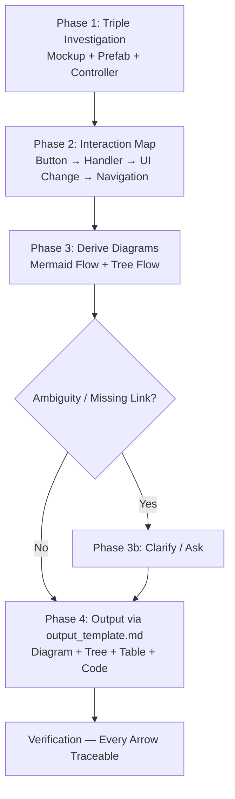

# Unity UI Controller Skill (`unity-ui-controller`)

Turn a **Mockup + Prefab + Controller code** triple into a **clickable UI flow spec** that answers: *when I tap this button, what happens next — which UI changes, which logic fires, which screen/popup navigates?*

**Core invariant — Mockup-Grounded, Prefab-Linked, Code-Verified:**
`Mockup elements → Prefab nodes → Controller bindings → Service / UIManager calls → UI state transition`.
Every flow arrow must be traceable to a real button in the mockup, a real `GameObject` in the prefab, and a real `onClick` wiring + handler in C#. No invented buttons, no invented navigation, no guessed service calls.

---

## When to Use

- Documenting how an existing screen/popup's buttons drive navigation, popups, and game state.
- Creating a new `*Controller.cs` for a mockup that already lists elements and visual layout.
- Explaining UI flow to a reviewer or implementer — flow diagram + tree + per-button detail.
- Auditing a controller's wiring (dynamic `onClick`, `DOKill` guards, `UIManager` keys, `ServiceLocator` calls).
- Generating `docs/specs/UIs/Controllers/<Name>_Controller.md` from a mockup.

## When NOT to Use

- Pure visual layout without interaction (use `unity-ui-mockup`).
- Non-UI gameplay systems (use `unity-document` / `unity-technical`).
- Asset-only prefab hierarchy docs with no click/logic flow.
- One-off code fix with no flow spec needed — just edit the `*Controller.cs` directly.

---

## 4-Phase Workflow (Mockup-First, Code-Verified)



### Phase 1: Triple Investigation (Evidence-First) — REQUIRED ORDER

Do NOT invent flows. Collect evidence in this exact order:

1. **Mockup — the interaction inventory (always first):**
   - Read `docs/specs/UIs/Mockups/<Name>_Mockup.md` for the full Visual Layout + Element Tree. List every tappable node: `Button`, `Button_Side`, `Button_Menu`, `Button_Text`, `Button_Icon`, `Toggle`, `Slider`, `CloseButton`, `Background_Dim`, etc.
   - Record per-button: label/text, icon, badge, and the mockup's stated destination (e.g. `UI.Offer1Popup`, `UI.SettingsPopup`, `LoadCurrentLevelAsync()`).
   - If mockup has a `Controller Bindings` section, note the claimed controller ↔ element pairing — will be verified against code.

2. **Prefab — the structural ground truth (second):**
   - Locate the `.prefab` under `Assets/_ZenoUI/Prefabs/` (or `Assets/**/Prefabs/`). Check `Screens/`, `Popups/`, and `_ZenoUI/Prefabs/` variants.
   - Extract hierarchy + components — **Unity MCP preferred, YAML fallback:**
     ```csharp
     // Canonical prefab walk — prefab is ground truth for GameObject ↔ component mapping
     System.Func<GameObject, int, string> fmt = null;
     fmt = (go, d) => {
         var sb = new System.Text.StringBuilder();
         var pad = new string(' ', d*2);
         var cs = go.GetComponents<Component>();
         var names = new System.Collections.Generic.List<string>();
         foreach (var c in cs) if (c != null) names.Add(c.GetType().Name);
         sb.AppendLine($"{pad}* `{go.name}` ({string.Join(", ", names)})");
         for (int i=0;i<go.transform.childCount;i++) sb.Append(fmt(go.transform.GetChild(i).gameObject, d+1));
         return sb.ToString();
     };
     var prefab = UnityEditor.AssetDatabase.LoadAssetAtPath<GameObject>("Assets/_ZenoUI/Prefabs/Screens/ScreenHome.prefab");
     return fmt(prefab, 0);
     ```
   - Note: which children are static in prefab vs. dynamically spawned (`SideMenuController` spawns `Button_Side`, `StoreScreenController` spawns `StoreSectionController` → `Card_Store`). Dynamic children still count as tappable — their prefab (`Button_Side.prefab`) is part of the evidence.

3. **Controller — the wiring & logic (third):**
   - Read `Assets/_ZenoUI/Scripts/Runtime/UIController/<Name>Controller.cs` (or `Feature/<Domain>/Scripts/Runtime/UI/` for Settings etc.).
   - Collect: `[SerializeField]` fields (which prefab nodes are wired), `Awake/OnInit/OnShow` lifecycle, `WireListeners()` / `UnwireListeners()` pattern (stored `UnityAction` identity), `onClick.AddListener(capturedIndex)`, `DOKill`/`DOPunchScale` guards, `UIManager.ShowScreenAsync` / `ShowPopupAsync` / `HidePopup` / `CloseAndDestroyPopup` keys, `ServiceLocator.Get<ICurrencyService|ILevelManager|ISettingManager|SoundManager|HapticManager>` calls, `EventBus` subscriptions, and test seams (`ShowPopupAsync<T>` virtual, `WireForTest`).
   - Also read sibling collaborators: `UIManager.cs`, `CanvasController.cs` (`Show`/`Hide` + `DOFade` + `IsVisible`), `ScreenCanvasController.cs`, `PopupCanvasController.cs`, and `ScriptableObjects/<Name>Settings.cs` for colours/pulse/timing.
   - If controller does NOT exist — record as new controller (mark `Controller: <Name>Controller.cs (to be created)` and propose namespace `ZenoGames.UI`, base `ScreenCanvasController` or `PopupCanvasController` or `MonoBehaviour` per spec).

4. **Related specs (context):**
   - Check `docs/specs/UIs/Screens/`, `Popups/`, `Elements/`, `Controllers/`, `Core/` for prior decisions (e.g. `Core/UIManager.md` for stack rules, `Elements/Button_Side.md` for `LayoutElement 72×72` + `Badge 36×36` contract).

### Phase 2: Interaction Map — Button → Handler → UI Change → Navigation

Build an explicit table before drawing any diagram. One row per tappable element (including dim/backdrop and hardware back if specified):

| # | Element (Mockup label → Prefab GO) | Prefab Node | Controller Field | `onClick` Wiring | Handler | UI Change | Logic / Service Call | Navigation |
|---|-------------------------------------|-------------|----------------|------------------|---------|-----------|----------------------|------------|
| 1 | `OFFER.1` (`Button_Side`) | `LeftMenu/Button_Side` | `SideMenuController.offers[0]` | `btn.onClick.AddListener(() => ShowPopupAsync("UI.Offer1Popup"))` | `OnOfferClicked(0)` | `DOPunchScale` + push stack | `UIManager.ShowPopupAsync<PopupCanvasController>("UI.Offer1Popup")` + `HapticType.Selection` | Stack: `Popup_Offer1` above `ScreenHome` |
| 2 | `Level 2 — TAP TO PLAY` (`Button_Text`) | `ScreenHome/Button_Text` | `PlayLevelController.playButton + levelText` | `playButton.onClick.AddListener(OnPlayClicked)` | `OnPlayClicked()` | `DOPunchScale` + level label `LV{N}` | `LevelManager.CurrentLevelIndex` + `LoadCurrentLevelAsync()` | `UIManager.ShowScreenAsync<ScreenPlay>` (future) |

Categories: **Aligned / Mockup-Only (no prefab) / Prefab-Only (no mockup label) / Code-Mismatch (mockup says X, code does Y)**. Every row gets a Verdict and disposition. Undecidable rows go to Phase 3b clarification — do not guess.

Rules:
- **No Inspector `onClick`** — all rows must show dynamic `AddListener` with stored `UnityAction` identity and `RemoveListener` in `OnDisable`/`OnHide`/`OnDestroy`.
- **Every navigation key is literal** — quote the exact Addressable key string (`"UI.SettingsPopup"`, `"UI.HomeScreen"`, `"UI.ConfirmPopup"`).
- **Service calls are explicit** — `ServiceLocator.TryGet<ICurrencyService>()`, `EventBus.Subscribe<CurrencyBalanceChangedEvent>`, `Time.timeScale = 0/1`, `SoundManager.PauseBGM()`, etc.
- **UI change is visual** — `DOKill` + `DOPunchScale` / `DOAnchorPosY` / `DOColor` / `DOFade` / `alpha` / `interactable` / `blocksRaycasts` / `SetActive`.

### Phase 3: Derive Diagrams from the Interaction Map

Diagrams are a **deterministic projection of the Interaction Map** — not a parallel invention. Every tappable row appears in both diagrams; no diagram-only arrows.

1. **Mermaid Flow Diagram (primary):**
   - Use `flowchart TD` (or `sequenceDiagram` when stack layering matters). One entry node per tappable element, one handler node, one logic/service node, one UI-state node, one navigation node. Colour by layer: tappable `#FFB800`, handler `#7B61FF`, service `#00A67D`, navigation `#FF3B30` when specified.
   - Include stack semantics: `PopupStack: A → B → C (Close C reveals B; closeAll empties)`, and `Screen: Hide(prev) → Show(next)`.
   - Show `DOKill` guard and `SetUpdate(true)` when `Time.timeScale == 0` matters (e.g. `PausePopup`).

2. **Tree Flow (hierarchical):**
   - Depth-first tree mirroring screen structure: `ScreenHome → LeftMenu (SideMenuController) → Button_Side[OFFER.1] → OnOfferClicked → ShowPopupAsync → Popup_Offer1`. Indent 2 spaces per level, backticked GO names, parenthesized action kind.
   - Each leaf shows `→ UI: <change> | Logic: <call> | Nav: <key>` on one line.

3. **Parity check before leaving Phase 3:** walk Interaction Map rows against both diagrams — every row ticks exactly one flow path and one tree leaf. Any unticked row is a violation.

### Phase 3b: Clarification (Only When Undecidable)

Only after Phases 1–2 if a row's Verdict is undecidable. Ask with explicit options:

- **Popup key unknown:** What is the Addressable key? (e.g. `UI.Offer1Popup` vs `UI.ShopPopup` — choose one literal)
- **Destructive guard:** Does this action require `ConfirmPopup`? (Yes → stacked `UI.ConfirmPopup` with `ConfirmResult.Confirmed`; No → direct)
- **Dim/backdrop:** Does tapping `Background_Dim` close the popup? (Yes → `HidePopup` / `CloseAndDestroyPopup`; No → explicit `CloseButton` only)
- **Persistent vs local:** Is this bar owned by `UIManager._canvasRoot` persistents or by this screen? (affects `ShowScreenAsync` hide semantics)
- **New controller base:** `ScreenCanvasController` / `PopupCanvasController` / `MonoBehaviour`? (drives `Show`/`Hide` + `CanvasGroup` lifecycle)

Present options directly; do not proceed to Output with an unresolved Mismatch row.

---

## Phase 4: Output Generation — MUST follow `references/output_template.md`

Generate or update the controller spec at `docs/specs/UIs/Controllers/<Name>_Controller.md`.

**Non-negotiable — output is template-governed:**

- Load the template via `read_skill_file("unity-ui-controller", "references/output_template.md")` and follow it **byte-for-byte structure** — do not invent sections, reorder blocks, or add wrappers.
- The canonical filled example is `docs/specs/UIs/Controllers/Home_Controller_Flow_Example.md` (embedded in the template) — `HomeScreenController` + `SideMenuController` + `PlayLevelController` + `TopMenuController` + `BottomMenuController`.
- Populate every placeholder (`<Name>`, `<PrefabName>`, `<ControllerClass>`, `<BaseClass>`, `<Namespace>`, `<Asmdef>`, `<Related_*>`, mermaid nodes, tree leaves, table rows, code). No `TODO`/`TBD`/`FIXME`.
- Header fields: `Date`, `Status`, `Prefab` (exact `.prefab` name or `(to be created)`), `Controller` (exact `.cs` path or `(to be created)`), `Related` links (relative to `../Screens/`, `../Popups/`, `../Elements/`, `../Mockups/`, `../Core/`).
- File-internal order is fixed per template: **Overview → Composition → Visual Reference → UI Flow Diagram → Tree Flow → Interaction Details → State Changes → Controller Code → Verification** — do not reorder.
- Every `Related` link, every `Prefab` node, and every `Controller` function/method in diagrams/tables must use inline code + optional markdown link to the real file. Example:
  - Prefab: `` [`ScreenHome.prefab`](../../../Assets/_ZenoUI/Prefabs/Screens/ScreenHome.prefab) `` + guid when known
  - Element: `` [`Button_Side`](../Elements/Button_Side.md) ``
  - Code: `` [`SideMenuController.OnOfferClicked`](../../../Assets/_ZenoUI/Scripts/Runtime/UIController/SideMenuController.cs:142) ``
  - Mockup: `` [`Home_Mockup`](../Mockups/Home_Mockup.md) ``
- Mermaid diagrams MUST be fenced as `` ```mermaid `` — never as plain code or image placeholder.

After populating, run Verification below before finishing.

### Verification (must pass before delivery)

- [ ] **Template adherence:** Structure matches `references/output_template.md` exactly — no missing/extra sections, no reordered blocks.
- [ ] **Triple evidence:** Mockup inventory, prefab struct, and controller wiring are all recorded; every Mismatch row has a disposition.
- [ ] **Flow completeness:** Every tappable element in mockup appears as one row in Interaction Details, one path in Mermaid Flow, and one leaf in Tree Flow — walk Interaction Details depth-first against both diagrams, zero unticked nodes.
- [ ] **Link discipline:** Every prefab GO, every element, every handler, and every service/UIManager key is quoted literally and linked to its file (`Assets/...`, `docs/specs/UIs/...`) where the file exists.
- [ ] **Code section:** Shows current controller code (or new controller scaffold) with smart comments on wiring, `DOKill` guards, and lifecycle. Code compiles against `ZenoGames.UI` + `ZenoGames.Interface` + `DOTween`.
- [ ] **No placeholders:** No `TODO`/`TBD`/`FIXME`; `**Related:**` links resolve; all mermaid blocks render.
- [ ] **Wiring contract:** All `onClick` rows show dynamic `AddListener` with stored `UnityAction` and `RemoveListener` in `OnDisable`/`OnHide`/`OnDestroy`; no Inspector `onClick`.

---

## Template Reference

All output structure lives in `references/output_template.md` — **do not duplicate it here**. Load it with:

```
read_skill_file("unity-ui-controller", "references/output_template.md")
```

Filled reference: `HomeScreenController` flow (`ScreenHome.prefab` guid `770dd50366a754d39ad489dbd600cccf` + `HomeScreenController.cs` + `SideMenuController.cs` + `PlayLevelController.cs`) — see template's embedded example.

---

## Formatting Rules (Non-Negotiable)

1. **Section Headers:** `### Overview` → `### Composition` → `### Visual Reference` → `### UI Flow Diagram` → `### Tree Flow` → `### Interaction Details` → `### State Changes` → `### Controller Code` → `### Verification` — exactly as in template. No extra sections, no `<details>`.
2. **Indentation:** Tree Flow uses exactly 2 spaces per depth (`* `, `  * `, `    * `, `      * `).
3. **Naming:** Backticked GO/method/key: `` `Button_Side` ``, `` `OnOfferClicked` ``, `` `"UI.SettingsPopup"` ``.
4. **Mermaid:** Fenced `` ```mermaid `` with `flowchart TD` or `sequenceDiagram`; test rendering.
5. **Links:** Relative markdown links for every element, prefab, mockup, and code file.
6. **No Placeholders:** Never leave `TODO`, `TBD`, `FIXME`.

---

## Common Anti-Patterns

| Anti-Pattern | Why It Fails | Correction |
|---|---|---|
| Inventing buttons not in mockup | Reviewer cannot trace flow to visual | Inventory mockup tappables first; every row starts from mockup |
| Drawing diagrams before Interaction Map | Diagrams drift from code | Build Interaction Map table first; derive diagrams strictly from it |
| Quoting guessed popup keys | Addressables load fails at runtime | Quote literal key from code or ask; never guess |
| Omitting `DOKill` / `RemoveListener` | Tweens stack; listeners leak on re-enable | Every row shows `DOKill` guard + stored `UnityAction` + `RemoveListener` |
| Inspector `onClick` | Breaks prefab override + test seam | Dynamic `AddListener` only; show wiring in Controller Code section |
| Missing service layer | Flow looks like UI-only magic | Every side effect names `ServiceLocator`, `EventBus`, or `UIManager` call |
| Code section with `TODO` | Spec is not implementable | Show current code verbatim or a compiling scaffold with smart comments |
