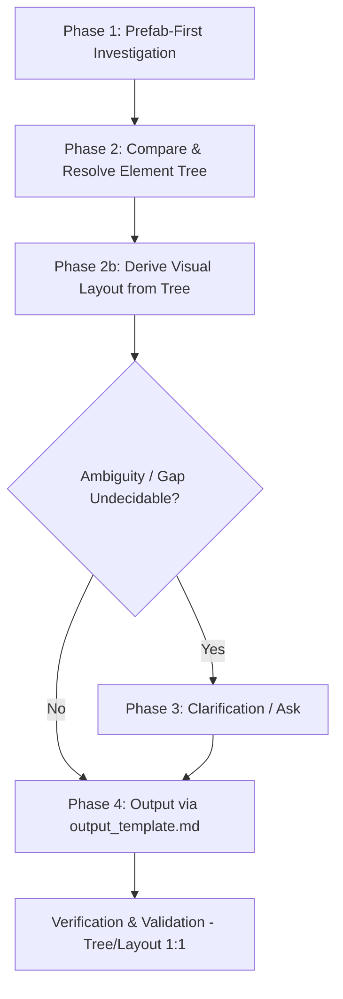

# Unity UI Mockup Skill (`unity-ui-mockup`)

Create standardized, evidence-backed Unity UI mockup documents that pair a **Visual Layout** with a complete, hierarchical **Element Tree** listing all attached Unity and custom components.

**Core invariant — Prefab-First, Tree-First, Layout-Matches-Tree:**
`Investigate prefab struct first → Compare with design → Resolve Element Tree → Derive Visual Layout 1:1 from Element Tree → Output via output_template.md`. Visual Layout MUST be an exact visual projection of the finalized Element Tree — no extra, missing, or renamed nodes.

---

## When to Use

- Creating new UI mockup specs for Screens, Popups, or HUD elements.
- Documenting existing Unity UI prefabs into visual/tree specs.
- Updating outdated UI mockups following prefab or controller changes.
- Standardizing UI documentation in `docs/specs/UIs/Mockups/` (or `Docs/Specs/UIs/Mockups/`).

## When NOT to Use

- Writing runtime C# code or UI controllers (use `unity-code` or standard implementation).
- Full Game Design Specs / GDDs (use `unity-spec`).
- Technical architecture / system documents (use `unity-document` or `unity-technical`).

---

## 4-Phase Workflow (Prefab-First)



> Generation order is **Element Tree → Visual Layout**. Output file order stays **Visual Layout → Element Tree** per `references/output_template.md` — do not reorder sections in the file. The invariant is: derive Layout strictly from the finalized Tree so the file renders Layout first but both represent the identical hierarchy.

### Phase 1: Prefab-First Investigation (Evidence-Based) — REQUIRED ORDER

Do NOT guess hierarchy or components. Do NOT start from the design image. Follow this exact sequence:

1. **Locate Prefab & Related Assets (always first)**:
   - Search for the `.prefab` file under `Assets/**/Prefabs/` (e.g. `ScreenHome.prefab`, `PopupShop.prefab`). Check both `Assets/` and `Assets/_Project/` variants.
   - Identify associated C# controllers (`*Controller.cs`, `*CanvasController.cs`, `*View.cs`) and their `[SerializeField]` bindings — these reveal child references even when YAML is minified.
   - Check related spec documents in `docs/specs/UIs/Screens/`, `Popups/`, `Elements/`, `Controllers/` for prior decisions.

2. **If prefab EXISTS — extract current struct as ground truth (mandatory)**:
   - **Primary (Unity MCP online):** Use `execute_code` to load the prefab via `AssetDatabase.LoadAssetAtPath` and walk `transform` recursively, collecting `GetComponents<Component>()` type names per GameObject. This is the canonical struct.
     ```csharp
     // Extract exact prefab GameObject tree + components — prefab is ground truth
     System.Func<GameObject, int, string> formatTree = null;
     formatTree = (targetGo, indent) => {
         var sb = new System.Text.StringBuilder();
         var indentStr = new string(' ', indent * 2);
         var comps = targetGo.GetComponents<Component>();
         var compNames = new System.Collections.Generic.List<string>();
         foreach (var c in comps) {
             if (c == null) continue;
             compNames.Add(c.GetType().Name);
         }
         sb.AppendLine(string.Format("{0}* `{1}` ({2})", indentStr, targetGo.name, string.Join(", ", compNames.ToArray())));
         for (int i = 0; i < targetGo.transform.childCount; i++) {
             sb.Append(formatTree(targetGo.transform.GetChild(i).gameObject, indent + 1));
         }
         return sb.ToString();
     };
     var prefab = UnityEditor.AssetDatabase.LoadAssetAtPath<GameObject>("Assets/_Path/To/Prefab.prefab");
     return formatTree(prefab, 0);
     ```
   - **Fallback (MCP offline):** Read the `.prefab` YAML directly for `m_Name`, `m_Component` typeIds, and `m_Father`/`m_RootOrder` hierarchy. Cross-check with controller serialized fields (`[SerializeField] private Button closeButton;`) to fill gaps.
   - **Record:** full indented tree with every component per node, plus notes: which children are static in prefab vs. dynamically instantiated sub-prefabs (e.g. `ContentContainer` spawns `Card_Achievement`).

3. **If prefab DOES NOT exist — record as new screen**:
   - Mark `Prefab: <New>.prefab (to be created)` in the mockup header.
   - Note controller/namespace conventions from sibling prefabs to propose consistent names. The Element Tree you produce becomes the creation spec.

4. **Collect Design Source (only after prefab struct is captured)**:
   - Figma frame / screenshot / `docs/specs/UIs/Mockups/*.md` prior version / ticket description / UX text.
   - List every visual region, card state, label, and icon the design shows — this is the target, not the ground truth.

### Phase 2: Compare & Resolve — Element Tree First

#### 2A — Compare prefab struct vs. design → produce gap table

Build an explicit comparison before editing the Tree. Use this table form (include in working notes; summarize deltas in mockup `Notes` if non-trivial):

| # | Element / Region | In Prefab | In Design | Verdict |
|---|------------------|-----------|-----------|---------|
| 1 | `Header/HeaderTitleText` | `TextMeshProUGUI` present | Title "ACHIEVEMENTS" + subtitle | ✅ Aligned |
| 2 | `ScrollRect/Viewport/ContentContainer` | Missing `ContentSizeFitter` | Scroll list with N cards | ⚠️ Add `ContentSizeFitter` + `VerticalLayoutGroup` |
| 3 | `Card_Achievement/ClaimButton` | `Button` disabled grey | Gradient orange "CLAIM" for claimable | ⚠️ Two-state variant required |

Categories: **Aligned / In Prefab Only / In Design Only / Mismatch (name/component/layout)**. Every row must have a Verdict and a disposition (keep / add / rename / remove / retarget).

#### 2B — Resolve final Element Tree (source of truth for everything after)

- Merge prefab ground truth + design deltas into **one finalized Element Tree**. Prefab is baseline; design is target; Verdict column drives the merge. Call out removals and renames explicitly — do not silently drop prefab children.
- **Every GameObject MUST list its Unity & custom components in parentheses `(...)`** — do not omit layout/mask/input components.
  - Transforms & Canvases: `RectTransform`, `Canvas`, `CanvasScaler`, `GraphicRaycaster`, `CanvasGroup`
  - Graphics: `CanvasRenderer`, `Image`, `TextMeshProUGUI`, `Mask`, `RectMask2D`
  - Controls: `Button`, `Toggle`, `Slider`, `ScrollRect`
  - Layout: `HorizontalLayoutGroup`, `VerticalLayoutGroup`, `GridLayoutGroup`, `ContentSizeFitter`, `LayoutElement`, `AspectRatioFitter`
  - Custom: `*CanvasController`, `*Controller`, `*ButtonController`
- For progress rows, model `ProgressBar` as `Slider` (`Background` + `FillArea`/`Fill` + `ProgressText`); reward as `RewardContainer` (`HorizontalLayoutGroup`) with `RewardIcon` + `RewardAmountText`; `ClaimButton` (`Image` + `Button` + `ClaimText`) with disabled vs. gradient claimable states. Include `LoadingIndicator` and `EmptyStateView` as siblings of `ScrollRect` when the screen loads async data (per Achievement pattern).
- **Do NOT invent elements at this stage that are not in the resolved Tree.** The Tree is now locked — all downstream work projects from it.

#### 2C — Derive Visual Layout strictly from the finalized Element Tree (1:1)

- **Visual Layout is a deterministic projection of the Element Tree — not a parallel invention.** Every node in the Tree appears in the Visual Layout at the same relative depth and with the same name/label; no Visual-only blocks, no Tree-only branches, no renaming between the two.
- Build in this order:
  1. **HTML View** (styled div) — map each Tree region 1:1: `Header` → header div, `ScrollRect → Viewport → ContentContainer` → scroll padding area with annotation `SCROLLRECT (Vertical) → Viewport (Mask) → ContentContainer (VerticalLayoutGroup)`, each `Card_<Item>` → one card div (show at least two states: In Progress `3/10` vs. Claimable `10/10` when applicable), `LoadingIndicator`/`EmptyStateView` → muted sibling blocks. Preserve names as labels inside the HTML where feasible.
  2. **Caption `<p>`** directly below HTML — one sentence naming the Root and its primary regions (e.g. "`<RootName>` — Header + ScrollRect (Viewport → ContentContainer) with `Card_<Item>` rows.").
  3. **ASCII Layout** (fenced block directly below caption) — box-drawing (`┌─`, `│`, `└─`) mirroring the same Tree hierarchy, same card variants, same labels. Never wrap in `<details>`.
- Rules for the derivation:
  - If the Tree has `Card_Achievement × N` under `ContentContainer`, the Visual shows exactly that multiplicity (2 concrete cards + one `⋯ More <Items>` placeholder for N>2, per template).
  - Layout/mask components (`VerticalLayoutGroup`, `Mask`, `ScrollRect`) that exist in the Tree MUST be annotated in the Visual's scroll caption line — they are not visual-only decorations.
  - Use clean padding and clear tokens (`[Button]`, `[Label]`, `[Icon]`) in ASCII; HTML-styled cards are preferred for scroll-list screens to distinguish states.
- **Parity check before leaving Phase 2:** walk the Tree depth-first and tick each node off against its Visual block. Any unticked node is a violation — fix the Visual (or, if truly non-visual like a pure `CanvasGroup` holder, still annotate it).

---

### Phase 3: Clarification (When to Ask)

Only after Phases 1–2 if a gap Verdict is undecidable from evidence. Ask the user with explicit options:

- **Destructive Actions**: Does cancel/confirm require a stacked confirmation dialog? (Yes → add `Popup_Confirm` link; No → single CTA)
- **Dismissal Policy**: Does tapping dim/backdrop close the popup, or is explicit CTA required?
- **Persistent vs Screen-Owned**: Are header/footer bars persistent canvas siblings or local to this screen?
- **Dynamic Content Bounds**: How many items/rows are expected in scroll areas or grids? (affects `ContentSizeFitter` + placeholder count)

*Present options directly; do not proceed to Output with an unresolved Mismatch row.*

---

### Phase 4: Output Generation — MUST follow `references/output_template.md`

Generate or update the mockup markdown at `docs/specs/UIs/Mockups/<Name>_Mockup.md` (or `Docs/Specs/UIs/Mockups/<Name>_Mockup.md`).

**Non-negotiable — output is template-governed:**

- Load the template via `read_skill_file("unity-ui-mockup", "references/output_template.md")` and follow it **byte-for-byte structure** — do not invent sections, reorder blocks, or add `Element Inventory` / `<details>` wrappers.
- The canonical filled example is `docs/specs/UIs/Mockups/Achievement_Mockup.md` (`ScreenAchievement` → `Header` + `ScrollRect` → `Viewport` → `ContentContainer` → `Card_Achievement` rows with `ProgressBar`/`RewardContainer`/`ClaimButton`, plus `LoadingIndicator`/`EmptyStateView`).
- Populate placeholders (`<Name>`, `<RootName>`, `<PrefabName>`, `<TITLE>`, card states, rewards, icons) with real values from the resolved Tree. No `TODO`/`TBD`/`FIXME`.
- File-internal order is fixed per template: **Visual Layout (HTML View → caption `<p>` → ASCII Layout fenced block) → Element Tree** — generation was Tree-first, but rendering stays Layout-first for readers.
- Header fields: `Date`, `Status`, `Prefab` (exact `.prefab` name or `(to be created)`), `Related` links (relative to `../Screens/`, `../Popups/`, `../Elements/`, `../Controllers/`).

After populating, run Verification & Validation below before finishing.

### Verification & Validation (must pass before delivery)

- [ ] **Template adherence:** Structure matches `references/output_template.md` exactly — no missing/extra sections, no `<details>`, no `Element Inventory` between Visual Layout and Element Tree.
- [ ] **Prefab-first evidence:** If prefab existed, its extracted struct is recorded and the gap table has a disposition for every Mismatch / In-Prefab-Only / In-Design-Only row.
- [ ] **Tree completeness:** Every node has backticked name and parenthesized component list; layout/mask/input components are not omitted.
- [ ] **Tree ↔ Visual 1:1 parity:** Every Tree node appears in Visual Layout at the same hierarchy depth with the same name/count, and vice versa. Walk Tree depth-first against Visual — zero unticked nodes.
- [ ] **Visual order:** `Visual Layout (HTML View) → caption <p> → ASCII Layout (fenced block directly below) → Element Tree`. ASCII is not wrapped in `<details>`.
- [ ] **Indentation:** Element Tree uses exactly 2 spaces per depth (`* `, `  * `, `    * `, `      * `).
- [ ] **Scroll hierarchy** (for list screens): `ScrollRect` → `Viewport` (Mask) → `ContentContainer` (`VerticalLayoutGroup` + `ContentSizeFitter`); cards use `LayoutElement`; at least two card-state variants when applicable.
- [ ] **No placeholders:** No `TODO`/`TBD`/`FIXME`; `**Related:**` links resolve.

---

## Template Reference

All output structure lives in `references/output_template.md` — **do not duplicate it here**. Load it with:

```
read_skill_file("unity-ui-mockup", "references/output_template.md")
```

Filled reference: `docs/specs/UIs/Mockups/Achievement_Mockup.md` (approved 2026-08-16, `ScreenAchievement.prefab`).

---

## Formatting Rules (Non-Negotiable)

1. **Section Headers**:
   - `### Visual Layout` → HTML View (styled div) → caption `<p>` → ASCII Layout (fenced block directly below) — exactly as in Achievement_Mockup.md. Never wrap ASCII in `<details>`.
   - `### Element Tree` → markdown bullet list with 2-space-per-depth indentation, every node `BacktickedName (Components)`. No `Element Inventory` between Visual Layout and Element Tree.
2. **Indentation**:
   - 2 spaces per hierarchy depth (`* `, `  * `, `    * `, `      * `).
3. **GameObject & Component Naming**:
   - Backticked GameObject name: `` `ObjectName` ``
   - Attached components in parentheses: `(RectTransform, CanvasRenderer, Image, Button)`
   - Include both standard Unity UI components and custom game controllers.
4. **Link Integrations**:
   - Include relative markdown links in `**Related:**` to screens, popups, elements, or controllers.
5. **No Placeholders**:
   - Never leave `TODO`, `TBD`, or `FIXME` in the final mockup spec.
6. **Generation invariant:**
   - Resolve Element Tree first; then derive Visual Layout strictly from it (1:1). Do not design Visual and Tree as independent artifacts.

---

## Common Anti-Patterns

| Anti-Pattern | Why It Fails | Correction |
|---|---|---|
| Fabricating hierarchy without checking prefabs | Mismatches Unity scene/prefab structure | Use Unity MCP `execute_code` or read `.prefab` YAML — prefab struct first |
| Starting from design image before reading prefab | Prefab ground truth is lost; Tree drifts | Always extract current prefab struct first, then compare with design (Phase 1 order) |
| Visual Layout drifting from Element Tree | Reviewers/impl see two conflicting specs | Derive Visual strictly from finalized Tree; run depth-first parity check |
| Omitting layout group / mask components | Developers miss required layout containers | Always include `HorizontalLayoutGroup`, `Mask`, `CanvasGroup`, etc. in Tree and annotate in Visual |
| Missing backticks around object names | Inconsistent markdown rendering | Wrap object names in backticks: `` `Header` `` |
| Using tabs instead of 2-space indentation | Broken nested bullet rendering | Use exact 2-space indent per level |
| Cluttered / non-aligned ASCII layouts | Hard to parse visual structure | Use standard box-drawing characters with clean padding |
| Using only ASCII for complex card states | Reviewers cannot distinguish claimable vs in-progress | Use HTML-styled cards with two state variants + ASCII Layout directly below HTML (Achievement pattern) |
| Omitting `LoadingIndicator` / `EmptyStateView` | Async states undocumented | Add them as siblings of `ScrollRect` per Achievement reference |
| Reordering or wrapping template sections | Breaks `output_template.md` contract | Follow template byte-for-byte; Visual → caption → ASCII → Tree, no `<details>` |

