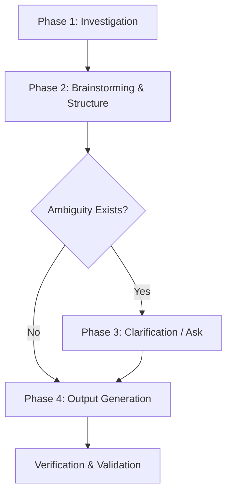

# Unity UI Mockup Skill (`unity-ui-mockup`)

Create standardized, evidence-backed Unity UI mockup documents that pair a **Visual Layout** with a complete, hierarchical **Element Tree** listing all attached Unity and custom components.

---

## When to Use

- Creating new UI mockup specs for Screens, Popups, or HUD elements.
- Documenting existing Unity UI prefabs into visual/tree specs.
- Updating outdated UI mockups following prefab or controller changes.
- Standardizing UI documentation in `docs/specs/UIs/Mockups/` (or `Docs/Specs/UIs/Mockups/`).

## When NOT to Use

- Writing runtime C# code or UI controllers (use `unity-code` or standard implementation).
- Full Game Design Specs / GDDs (use `unity-spec`).
- Technical architecture / system documents (use `unity-document` or `unity-technical`).

---

## 4-Phase Workflow



### Phase 1: Investigation (Evidence-Based)

Do NOT guess the element hierarchy or component names. Gather hard evidence:

1. **Locate Prefab & Related Assets**:
   - Search for the `.prefab` file under `Assets/**/Prefabs/` (e.g. `ScreenHome.prefab`, `Popup.prefab`).
   - Identify associated C# controllers (`*Controller.cs`, `*CanvasController.cs`).
   - Check related spec documents in `docs/specs/UIs/Screens/`, `Popups/`, `Elements/`, `Controllers/`.

2. **Inspect Hierarchy & Components via Unity MCP**:
   - If Unity Editor is running with Unity MCP, use `execute_code` to extract the exact GameObject tree and component types:
     ```csharp
     System.Func<GameObject, int, string> formatTree = null;
     formatTree = (targetGo, indent) => {
         var sb = new System.Text.StringBuilder();
         var indentStr = new string(' ', indent * 2);
         var comps = targetGo.GetComponents<Component>();
         var compNames = new System.Collections.Generic.List<string>();
         foreach (var c in comps) {
             if (c == null) continue;
             compNames.Add(c.GetType().Name);
         }
         sb.AppendLine(string.Format("{0}* `{1}` ({2})", indentStr, targetGo.name, string.Join(", ", compNames.ToArray())));
         for (int i = 0; i < targetGo.transform.childCount; i++) {
             sb.Append(formatTree(targetGo.transform.GetChild(i).gameObject, indent + 1));
         }
         return sb.ToString();
     };
     var prefab = UnityEditor.AssetDatabase.LoadAssetAtPath<GameObject>("Assets/_Path/To/Prefab.prefab");
     return formatTree(prefab, 0);
     ```
   - If Unity MCP is offline, read the `.prefab` YAML file or inspect controller serialized fields (`[SerializeField] private Button closeButton;`, etc.) to map out children and components.

3. **Check Dynamic vs Static Elements**:
   - Note which elements are static children in the prefab (e.g. `Background_Dim`, `HeaderTitle`, `CloseButton`).
   - Note dynamically instantiated sub-prefabs (e.g. list items spawned into `ContentContainer`, banner cards).

---

### Phase 2: Brainstorming & Gap Analysis

1. **Visual Composition**:
   - Identify visual regions: Top/Header, Safe Area / Center Viewport, Side Menus, Bottom Navigation, Footer, Overlay / Backdrop.
   - Plan representation: **HTML-styled mockup + ASCII wireframe fallback** is preferred for scroll-list/card screens (see Achievement pattern below); ASCII-only box-drawing is always valid for simple screens.
   - For achievement/milestone-style lists, follow the Achievement reference: header with title + accent line + subtitle, scroll area annotated `SCROLLRECT (Vertical) → Viewport (Mask) → ContentContainer (VerticalLayoutGroup)`, one `Card_<Item>` per row showing at least two states (e.g. In Progress `3/10` vs Claimable `10/10`), legend mapping colors to states, and `○ = soft currency` reward badge.
   - Use clean box-drawing borders (`┌─`, `│`, `└─`) and clear labels (`[Button]`, `[Label]`, `[Icon]`) for the ASCII layer.

2. **Component Mapping**:
   - Every GameObject in the tree MUST have its Unity & custom components listed inside parentheses `(...)`.
   - Core components to track:
     - Transforms & Canvases: `RectTransform`, `Canvas`, `CanvasScaler`, `GraphicRaycaster`, `CanvasGroup`
     - Graphics & Visuals: `CanvasRenderer`, `Image`, `TextMeshProUGUI`, `Mask`, `RectMask2D`
     - Controls & Input: `Button`, `Toggle`, `Slider`, `ScrollRect`
     - Layout: `HorizontalLayoutGroup`, `VerticalLayoutGroup`, `GridLayoutGroup`, `ContentSizeFitter`, `LayoutElement`, `AspectRatioFitter`
     - Custom Controllers: `*CanvasController`, `*Controller`, `*ButtonController`
   - For progress rows, model `ProgressBar` as `Slider` with `Background` + `FillArea`/`Fill` + `ProgressText`; group reward as `RewardContainer` (`HorizontalLayoutGroup`) with `RewardIcon` + `RewardAmountText`; keep `ClaimButton` (`Image` + `Button` + `ClaimText`) with disabled vs gradient claimable states. Include `LoadingIndicator` and `EmptyStateView` as siblings of `ScrollRect` when the screen loads async data (Achievement pattern).

---

### Phase 3: Clarification (When to Ask)

Ask the user if any of the following are ambiguous:
- **Destructive Actions**: Does a cancel/confirm require a stacked confirmation dialog?
- **Dismissal Policy**: Does tapping outside/dim close the popup, or is explicit CTA required?
- **Persistent vs Screen-Owned**: Are header/footer bars persistent canvas siblings or local to this screen?
- **Dynamic Content Bounds**: How many items/rows are expected in scroll areas or grids?

*When asking, present clear options directly to the user.*

---

### Phase 4: Output Generation

Generate or update the mockup markdown file at:
`docs/specs/UIs/Mockups/<Name>_Mockup.md` (or `Docs/Specs/UIs/Mockups/<Name>_Mockup.md`).

The document MUST adhere to the template at `references/output_template.md`:

- Load it via `read_skill_file("unity-ui-mockup", "references/output_template.md")` and follow it exactly — do not invent a different structure.
- The canonical filled example is `docs/specs/UIs/Mockups/Achievement_Mockup.md` (`ScreenAchievement` → `Header` + `ScrollRect` → `Viewport` → `ContentContainer` → `Card_Achievement` rows with `ProgressBar`/`RewardContainer`/`ClaimButton`, plus `LoadingIndicator`/`EmptyStateView`).

After populating the template, run Verification & Validation below before finishing.

### Verification & Validation

- Visual Layout present (HTML-styled or ASCII) and Element Tree indentation is exactly 2 spaces per depth.
- Every node has backticked name and parenthesized component list; layout/mask/input components are not omitted.
- Scroll hierarchy is `ScrollRect` → `Viewport` (Mask) → `ContentContainer` (`VerticalLayoutGroup` + `ContentSizeFitter`) for list screens; card rows use `LayoutElement` and document both In Progress and Claimable states when applicable.
- No `TODO`/`TBD`/`FIXME` remains; `**Related:**` links resolve.

---

## Template Reference

All output structure lives in `references/output_template.md` — **do not duplicate it here**. Load it with:

```
read_skill_file("unity-ui-mockup", "references/output_template.md")
```

Filled reference: `docs/specs/UIs/Mockups/Achievement_Mockup.md` (approved 2026-08-16, `ScreenAchievement.prefab`).

---

## Formatting Rules (Non-Negotiable)

1. **Section Headers**:
   - `### Visual Layout` followed by HTML mockup and/or ASCII fenced block (when using HTML, include ASCII wireframe in `<details>`).
   - `### Element Tree` followed by the markdown bullet list; `### Element Inventory` after the tree when needed.
2. **Indentation**:
   - 2 spaces per hierarchy depth (`* `, `  * `, `    * `, `      * `).
3. **GameObject & Component Naming**:
   - Backticked GameObject name: `` `ObjectName` ``
   - Attached components in parentheses: `(RectTransform, CanvasRenderer, Image, Button)`
   - Include both standard Unity UI components and custom game controllers.
4. **Link Integrations**:
   - Include relative markdown links in `**Related:**` to screens, popups, elements, or controllers.
5. **No Placeholders**:
   - Never leave `TODO`, `TBD`, or `FIXME` in the final mockup spec.

---

## Common Anti-Patterns

| Anti-Pattern | Why It Fails | Correction |
|---|---|---|
| Fabricating hierarchy without checking prefabs | Mismatches Unity scene/prefab structure | Use Unity MCP `execute_code` or read `.prefab` YAML |
| Omitting layout group / mask components | Developers miss required layout containers | Always include `HorizontalLayoutGroup`, `Mask`, `CanvasGroup`, etc. |
| Missing backticks around object names | Inconsistent markdown rendering | Wrap object names in backticks: `` `Header` `` |
| Using tabs instead of 2-space indentation | Broken nested bullet rendering | Use exact 2-space indent per level |
| Cluttered / non-aligned ASCII layouts | Hard to parse visual structure | Use standard box-drawing characters with clean padding |
| Using only ASCII for complex card states | Reviewers cannot distinguish claimable vs in-progress | Use HTML-styled cards with two state variants + ASCII fallback in `<details>` (Achievement pattern) |
| Omitting `LoadingIndicator` / `EmptyStateView` | Async states undocumented | Add them as siblings of `ScrollRect` per Achievement reference |
